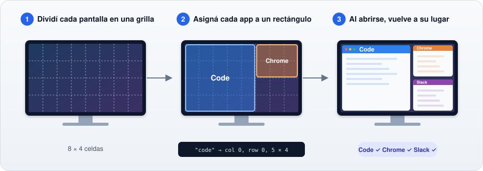
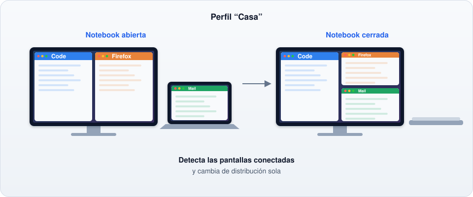
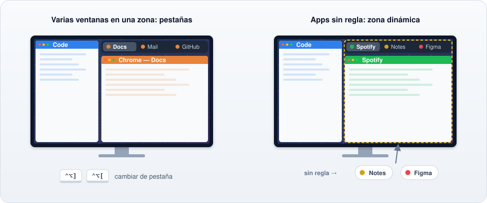
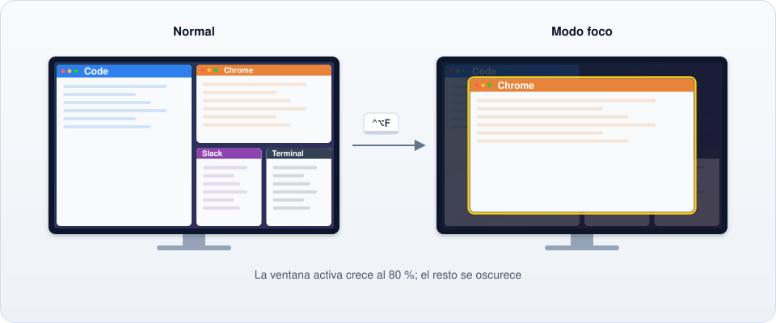
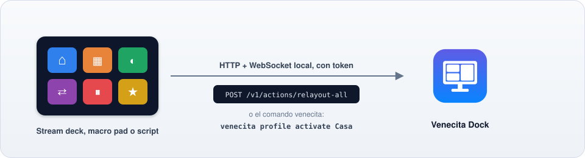

<p align="center">
  
</p>

<h1 align="center">Venecita Dock</h1>

<p align="center">
  Un gestor de ventanas para el teclado que <b>recuerda dónde va cada aplicación</b>.<br>
  macOS y Windows 10/11 · Hecho en Rust · GPL-3.0
</p>

<p align="center">
  <a href="README.md">English</a> · <b>Español</b>
</p>

<p align="center">
  <a href="https://github.com/pimgux/venecita/releases/latest"><b>Descargar</b></a> ·
  <a href="#instalación">Instalar</a> ·
  <a href="docs/CONFIG.md">Configuración</a> ·
  <a href="docs/API.md">API y CLI</a>
</p>

<p align="center">
  
</p>

---

## Para qué sirve

Herramientas como Rectangle acomodan ventanas rápido, pero se olvidan de todo apenas cerrás
una app. Venecita Dock divide cada monitor en una grilla y le da a cada aplicación su
propio rectángulo de celdas. Cada vez que esa app se abre, su ventana vuelve al mismo lugar.



## Un perfil por escritorio, una distribución por pantallas

Un **perfil** es un lugar de trabajo (casa, oficina, viaje). Cada perfil tiene
**distribuciones** para las pantallas que usás ahí, por ejemplo "notebook abierta" y
"notebook cerrada". Venecita Dock detecta qué pantallas están conectadas y cambia de
distribución solo: cuando cerrás la notebook no tenés que hacer nada.



En la ventana de ajustes podés duplicar una distribución, copiarla a otro perfil o copiar sus
reglas a otra distribución. Las reglas de una pantalla que la otra distribución no usa se
saltean.

## Pestañas y zona dinámica

Cuando varias ventanas comparten una zona (por ejemplo, tres ventanas de Chrome), quedan
apiladas y aparece una **barra de pestañas** encima. Tocá una pestaña o usá un atajo para
cambiar.

Las apps **sin regla** van a la **zona dinámica**, que también tiene pestañas. Así las apps
nuevas nunca quedan desparramadas por la pantalla.



## Modo foco

Apretá <kbd>⌃</kbd><kbd>⌥</kbd><kbd>F</kbd>. La ventana activa crece a cerca del 80 % de la
pantalla y todo lo demás se oscurece. Apretalo de nuevo, o pasá a otra ventana (con un clic,
<kbd>⌘</kbd><kbd>Tab</kbd>, una pestaña…), y vuelve a su lugar.



## Todo desde el teclado

Cada acción tiene un atajo, y podés cambiarlos todos desde la ventana de ajustes.

| Atajo | Acción |
|---|---|
| <kbd>⌃</kbd><kbd>⌥</kbd> + flechas | Mover la ventana a la zona de al lado |
| <kbd>⌃</kbd><kbd>⌥</kbd><kbd>⇧</kbd> + flechas | Agrandar la ventana |
| <kbd>⌃</kbd><kbd>⌥</kbd><kbd>⌘</kbd> + flechas | Achicar la ventana |
| <kbd>⌃</kbd><kbd>⌥</kbd><kbd>N</kbd> / <kbd>B</kbd> | Pasar a la pantalla siguiente / anterior |
| <kbd>⌃</kbd><kbd>⌥</kbd><kbd>P</kbd> | Recordar esta app acá (crea la regla) |
| <kbd>⌃</kbd><kbd>⌥</kbd><kbd>R</kbd> | Ordenar todas las ventanas |
| <kbd>⌃</kbd><kbd>⌥</kbd><kbd>F</kbd> | Modo foco |
| <kbd>⌃</kbd><kbd>⌥</kbd><kbd>]</kbd> / <kbd>[</kbd> | Pestaña siguiente / anterior |
| <kbd>⌃</kbd><kbd>⌥</kbd><kbd>0</kbd> | Perfil siguiente |

En Windows, <kbd>⌃</kbd> es Ctrl, <kbd>⌥</kbd> es Alt y <kbd>⌘</kbd> es la tecla Windows.

## Stream decks, macro pads y scripts

Una API local (HTTP + WebSocket, protegida con un token) y el comando `venecita` permiten
que otras herramientas controlen Venecita Dock: ordenar las ventanas, cambiar de perfil,
activar el modo foco o enterarse de los cambios. Ver [`docs/API.md`](docs/API.md).



```sh
venecita action relayout-all
venecita profile activate Casa
```

## Funciones

- **Lugar fijo para cada aplicación** en la grilla que elijas (8 × 4 por monitor de forma
  predeterminada; cada monitor puede tener la suya).
- **Perfiles y distribuciones** que se eligen solos según los monitores conectados.
- **Pestañas** para las ventanas que comparten zona, y una **zona dinámica** para las apps
  sin regla.
- **Modo foco**, y una capa oscura que hace resaltar la ventana activa.
- **Ordenar automáticamente**: si movés una ventana a mano, vuelve a su zona.
- **Ventana de ajustes** en español e inglés, con un editor visual de distribuciones:
  arrastrá sobre la grilla para crear una zona y después movela o cambiale el tamaño con el
  mouse.
- **API local y CLI**, ícono en la barra de menú o en la bandeja, inicio automático,
  separación entre ventanas y una lista de apps ignoradas.

## Instalación

Descargá la última versión desde [Releases](https://github.com/pimgux/venecita/releases/latest):

- **macOS** (11 o posterior, Intel o Apple Silicon): abrí `venecita-dock-…-macos.dmg` y
  arrastrá **Venecita Dock** a Aplicaciones. La primera vez, dale el permiso de
  **Accesibilidad** (Ajustes del Sistema → Privacidad y seguridad → Accesibilidad). La app
  todavía no está firmada con un Developer ID, así que macOS puede decir que no la puede
  verificar: la primera vez, clic derecho → *Abrir*, y después de actualizar volvé a dar el
  permiso.
- **Windows** (10 u 11): ejecutá `venecita-dock-…-windows-x86_64.msi`. Se instala solo para
  tu usuario (no hace falta ser administrador), agrega Venecita Dock al menú Inicio y deja el
  comando `venecita` en el PATH. También hay un zip con los `.exe` sueltos.

Cada descarga tiene un archivo `.sha256` para verificarla.

### Notas para Windows

- El ejecutable todavía no está firmado, así que SmartScreen puede avisar la primera vez:
  elegí *Más información → Ejecutar de todas formas*.
- La configuración está en `%APPDATA%\venecita-dock\config.toml` y los logs en
  `%LOCALAPPDATA%\venecita-dock\logs\`.
- Las apps se identifican por el nombre del ejecutable, por ejemplo
  `apps = ["code.exe", "firefox.exe"]` (el `.exe` es opcional), o por el nombre del producto
  (`"Visual Studio Code"`).
- Una app normal no puede mover ventanas de apps que corren como administrador (Windows no
  lo permite). Si lo necesitás, ejecutá Venecita Dock como administrador también.
- Muchas combinaciones de <kbd>Win</kbd> + tecla las reserva Windows.

## Configuración

Los ajustes se guardan en un archivo TOML fácil de leer (ver
[`examples/config.toml`](examples/config.toml) y [`docs/CONFIG.md`](docs/CONFIG.md)). Podés
cambiarlo desde la ventana de ajustes o a mano: Venecita Dock lo vuelve a leer apenas
guardás, y respeta tus comentarios.

## Compilar

```sh
# Hace falta Rust (https://rustup.rs)
cargo build --release
cargo test --workspace

# Abrir la app de la barra de menú
cargo run --release -p venecita-app --bin venecita-dock
```

Paquetes: `scripts/bundle-macos.sh` arma `dist/Venecita Dock.app` y un DMG (`UNIVERSAL=1`
para Intel + Apple Silicon). `wix/venecita.wxs` es el instalador de Windows (WiX 5). Al subir
un tag `v*` se arman y publican los dos. Las imágenes de este README las genera
`scripts/readme-images.py`.

## Estado y hoja de ruta

La versión **0.1.3** funciona en macOS y Windows 10/11. El soporte de Linux (X11) está listo
y se prueba en CI; la app de bandeja para Linux viene después.

| Fase | Alcance | |
|---|---|---|
| 0–1 | Repositorio, CI, lógica central y configuración | ✅ |
| 2–3 | Soporte de macOS, ubicación automática y perfiles | ✅ |
| 4–5 | Atajos, pilas, zona dinámica y barra de pestañas | ✅ |
| 6 | Modo foco | ✅ |
| 7 | Ventana de ajustes (egui) en español e inglés | ✅ |
| 8 | API local y CLI | ✅ |
| 9 | Soporte de Windows | ✅ |
| 10 | Paquetes (DMG, MSI) y soporte de Linux | ✅ / falta la app de bandeja |

Las especificaciones están en [`docs/specs/`](docs/specs/) y la arquitectura en
[`docs/ARCHITECTURE.md`](docs/ARCHITECTURE.md) (en inglés).

## Contribuir

Ver [CONTRIBUTING.md](CONTRIBUTING.md) (en inglés). Las contribuciones son bienvenidas; por
favor mantené el código claro y bien comentado.

## Licencia

GPL-3.0 o posterior. Ver [LICENSE](LICENSE).
