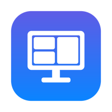
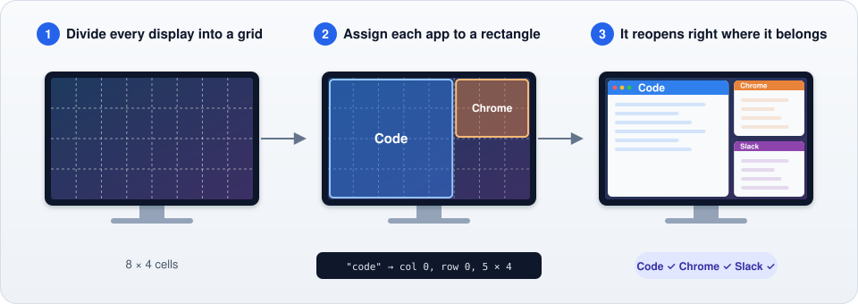
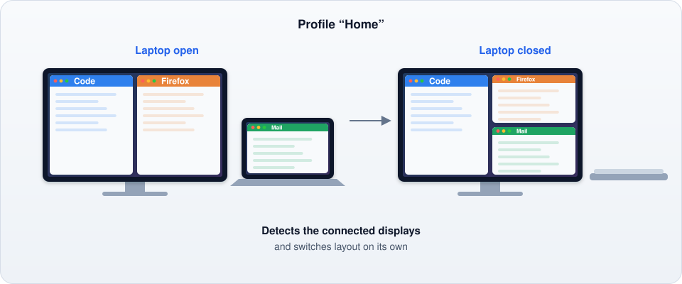
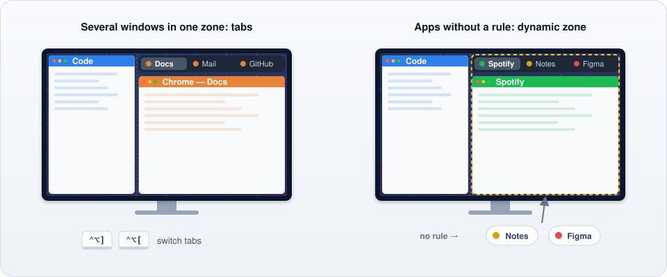
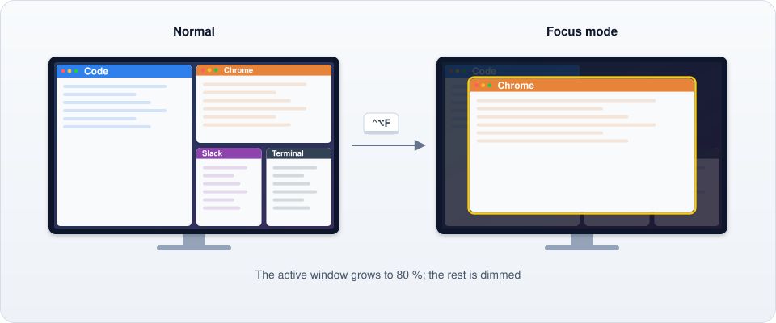
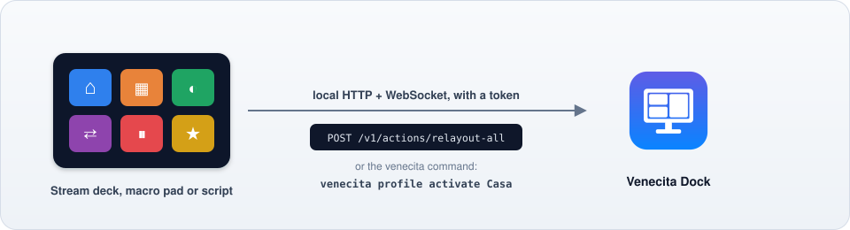

<p align="center">
  
</p>

<h1 align="center">Venecita Dock</h1>

<p align="center">
  A keyboard-driven window manager that <b>remembers where every application belongs</b>.<br>
  macOS and Windows 10/11 · Written in Rust · GPL-3.0
</p>

<p align="center">
  <b>English</b> · <a href="README.es.md">Español</a>
</p>

<p align="center">
  <a href="https://github.com/pimgux/venecita/releases/latest"><b>Download</b></a> ·
  <a href="#installing">Install</a> ·
  <a href="docs/CONFIG.md">Configuration</a> ·
  <a href="docs/API.md">API and CLI</a>
</p>

<p align="center">
  
</p>

---

## Why

Tools like Rectangle snap windows quickly, but they forget the layout as soon as you close
an app. Venecita Dock divides every monitor into a grid and gives each application its own
rectangle of cells. Each time that app opens, its window goes back to the same place.



## One profile per desk, one layout per screen setup

A **profile** is a desk (home, work, travelling). Each profile has **layouts** for the
screens you use there, such as "laptop open" and "laptop closed". Venecita Dock detects which
displays are connected and switches layout on its own. You don't have to do anything when
you close the lid.



In the settings window you can duplicate a layout, copy it to another profile, or copy its
rules to another layout. Rules on a display that the target layout doesn't use are skipped.

## Tabs and the dynamic zone

When several windows share a zone (three Chrome windows, for example), they are stacked and
a **tab bar** appears on top of them. Click a tab or use a shortcut to switch.

Apps **without a rule** go to the **dynamic zone**, which also has tabs, so new apps never end
up scattered across the screen.



## Focus mode

Press <kbd>⌃</kbd><kbd>⌥</kbd><kbd>F</kbd>. The active window grows to about 80 % of the
screen and everything else is dimmed. Press it again, or switch to another window
(click it, <kbd>⌘</kbd><kbd>Tab</kbd>, a tab…), and it goes back to its place.



## Everything from the keyboard

Every action has a shortcut, and you can change all of them from the settings window.

| Shortcut | Action |
|---|---|
| <kbd>⌃</kbd><kbd>⌥</kbd> + arrows | Move the window to the next zone |
| <kbd>⌃</kbd><kbd>⌥</kbd><kbd>⇧</kbd> + arrows | Grow the window |
| <kbd>⌃</kbd><kbd>⌥</kbd><kbd>⌘</kbd> + arrows | Shrink the window |
| <kbd>⌃</kbd><kbd>⌥</kbd><kbd>N</kbd> / <kbd>B</kbd> | Move to the next / previous display |
| <kbd>⌃</kbd><kbd>⌥</kbd><kbd>P</kbd> | Remember this app here (creates the rule) |
| <kbd>⌃</kbd><kbd>⌥</kbd><kbd>R</kbd> | Arrange every window |
| <kbd>⌃</kbd><kbd>⌥</kbd><kbd>F</kbd> | Focus mode |
| <kbd>⌃</kbd><kbd>⌥</kbd><kbd>]</kbd> / <kbd>[</kbd> | Next / previous tab |
| <kbd>⌃</kbd><kbd>⌥</kbd><kbd>0</kbd> | Next profile |

On Windows, <kbd>⌃</kbd> is Ctrl, <kbd>⌥</kbd> is Alt and <kbd>⌘</kbd> is the Windows key.

## Stream decks, macro pads and scripts

A local API (HTTP + WebSocket, protected by a token) and the `venecita` command let other
tools control Venecita Dock: arrange the windows, switch profile, toggle focus mode, or
listen for changes. See [`docs/API.md`](docs/API.md).



```sh
venecita action relayout-all
venecita profile activate Home
```

## Features

- **Per-application placement** on a grid you choose (8 × 4 per monitor by default; each
  monitor can have its own).
- **Profiles and layouts** detected from the connected monitors.
- **Tabs** for windows that share a zone, and a **dynamic zone** for apps without a rule.
- **Focus mode**, and a dim layer that makes the focused window stand out.
- **Arrange automatically**: if you move a window by hand, it goes back to its zone.
- **Settings window** in English and Spanish, with a visual layout editor: drag on the grid
  to create a zone, then move or resize it with the mouse.
- **Local API and CLI**, menu-bar or tray icon, launch at login, gaps between windows, and a
  list of ignored apps.

## Installing

Download the latest version from [Releases](https://github.com/pimgux/venecita/releases/latest):

- **macOS** (11 or later, Intel or Apple Silicon): open `venecita-dock-…-macos.dmg` and drag
  **Venecita Dock** to Applications. On first start, grant the **Accessibility** permission
  (System Settings → Privacy & Security → Accessibility). The app isn't signed with a
  Developer ID yet, so macOS may say it can't check it: right-click it → *Open* the first
  time, and grant the permission again after updating.
- **Windows** (10 or 11): run `venecita-dock-…-windows-x86_64.msi`. It installs for your user
  only (no administrator rights), adds Venecita Dock to the Start menu and puts the `venecita`
  command on your PATH. A zip with the plain `.exe` files is there too.

Each download has a `.sha256` file to check it.

### Windows notes

- The executable isn't signed yet, so SmartScreen may warn you the first time: choose
  *More info → Run anyway*.
- The configuration is `%APPDATA%\venecita-dock\config.toml` and the logs are in
  `%LOCALAPPDATA%\venecita-dock\logs\`.
- Apps are identified by their executable name, e.g. `apps = ["code.exe", "firefox.exe"]`
  (the `.exe` is optional), or by their product name (`"Visual Studio Code"`).
- Windows of apps running as administrator can't be moved by a normal app (Windows doesn't
  allow it). Run Venecita Dock as administrator too if you need that.
- Many <kbd>Win</kbd> + key combinations are reserved by Windows itself.

## Configuration

Settings are stored in a readable TOML file (see [`examples/config.toml`](examples/config.toml)
and [`docs/CONFIG.md`](docs/CONFIG.md)). Change it from the settings window or edit it by
hand: Venecita Dock reloads it as soon as you save, and keeps your comments.

## Building

```sh
# Requires Rust (https://rustup.rs)
cargo build --release
cargo test --workspace

# Run the menu-bar app
cargo run --release -p venecita-app --bin venecita-dock
```

Packages: `scripts/bundle-macos.sh` builds `dist/Venecita Dock.app` and a DMG
(`UNIVERSAL=1` for Intel + Apple Silicon). `wix/venecita.wxs` is the Windows installer
(WiX 5). Pushing a tag `v*` builds and publishes both. The images in this README are made by
`scripts/readme-images.py`.

## Status and roadmap

Version **0.1.3** runs on macOS and Windows 10/11. The Linux (X11) backend is ready and
tested in CI; the Linux tray app comes later.

| Phase | Scope | |
|---|---|---|
| 0–1 | Repository, CI, core logic and configuration | ✅ |
| 2–3 | macOS backend, automatic placement and profiles | ✅ |
| 4–5 | Shortcuts, stacks, dynamic zone and tab bar | ✅ |
| 6 | Focus mode | ✅ |
| 7 | Settings window (egui) in English and Spanish | ✅ |
| 8 | Local API and CLI | ✅ |
| 9 | Windows backend | ✅ |
| 10 | Packaging (DMG, MSI) and Linux backend | ✅ / tray app pending |

Specifications live in [`docs/specs/`](docs/specs/), and the architecture overview in
[`docs/ARCHITECTURE.md`](docs/ARCHITECTURE.md).

## Contributing

See [CONTRIBUTING.md](CONTRIBUTING.md). Contributions are welcome; please keep the code clear
and well commented.

## License

GPL-3.0-or-later. See [LICENSE](LICENSE).
